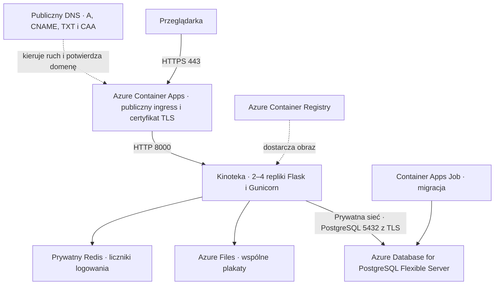

# L3 · Projekt architektury chmurowej Kinoteki

Kinoteka działa na Flasku i Gunicornie oraz przechowuje dane w PostgreSQL. Projekt wykorzystuje subskrypcję Azure for Students i profil Consumption w Azure Container Apps. Domyślny region to France Central, dostępny w polityce tej subskrypcji. [Kod Kinoteki](https://github.com/nipokonany65371/kinoteka)

## Wymagania L3

| Wymaganie | Konfiguracja |
|---|---|
| Load balancer ze skalowaniem | Publiczny ingress Azure Container Apps rozdziela ruch między repliki. Domyślny ingress skaluje własną pojemność niezależnie od aplikacji. Reguła HTTP skaluje Kinotekę między 2 a 4 replikami. Próg startowy to 10 równoczesnych żądań na replikę, do sprawdzenia testem obciążenia. [Ingress środowiska](https://learn.microsoft.com/en-us/azure/container-apps/ingress-environment-configuration), [skalowanie aplikacji](https://learn.microsoft.com/en-us/azure/container-apps/scale-app) |
| Baza gotowa do skalowania | PostgreSQL 17 Flexible Server w prywatnej podsieci z prywatną strefą DNS. Konfiguracja startowa to Burstable B1ms i 32 GiB, z automatycznym zwiększaniem dysku. Przy większym obciążeniu można zmienić klasę obliczeniową. Po przejściu na obsługiwany poziom można dołączyć repliki odczytu i kierować do nich zapytania tolerujące opóźnienie. [Prywatna sieć](https://learn.microsoft.com/en-us/azure/postgresql/flexible-server/concepts-networking), [skalowanie dysku](https://learn.microsoft.com/en-us/azure/postgresql/flexible-server/how-to-auto-grow-storage), [repliki odczytu](https://learn.microsoft.com/en-us/azure/postgresql/read-replica/concepts-read-replicas) |
| Domena publiczna | Domena główna `kinoteka.net.pl` ma rekord `A` wskazujący na stały adres środowiska Azure Container Apps `20.19.75.4`. Subdomena `app.kinoteka.net.pl` ma rekord `CNAME` wskazujący bezpośrednio na publiczny adres aplikacji w `azurecontainerapps.io`. Azure weryfikuje obie nazwy przez odpowiadające im rekordy `TXT` z prefiksem `asuid`. [Konfiguracja domeny](https://learn.microsoft.com/en-us/azure/container-apps/custom-domains-managed-certificates) |
| Certyfikat SSL/TLS poza serwerem aplikacji | Azure Container Apps wystawia i odnawia zarządzany certyfikat po weryfikacji domeny. TLS kończy się na ingressie. Azure przekierowuje publiczne HTTP na HTTPS, a Gunicorn obsługuje ruch wewnętrzny na porcie `8000`. [Certyfikat zarządzany](https://learn.microsoft.com/en-us/azure/container-apps/custom-domains-managed-certificates), [terminacja TLS](https://learn.microsoft.com/en-us/azure/container-apps/ingress-overview) |

## Skalowanie i wdrożenie L4

- Aplikacja używa wspólnego klucza sesji i montuje ten sam udział Azure Files we wszystkich replikach. Plakat dodany na jednej replice jest dostępny z pozostałych. [Azure Files](https://learn.microsoft.com/en-us/azure/container-apps/storage-mounts)
- Flask-Limiter zapisuje wspólne liczniki w wewnętrznym kontenerze Redis z hasłem. W konfiguracji laboratoryjnej liczniki wygasają również po restarcie Redis. Blokady kont pozostają w PostgreSQL.
- Jednorazowy Container Apps Job wykonuje migracje i przyznaje osobnemu użytkownikowi aplikacji dostęp do tabel. Repliki aplikacji uruchamiają wyłącznie Gunicorna. Próba `/live` sprawdza działanie procesu, a `/health` dodatkowo sprawdza połączenie z bazą.
- Obraz jest wersjonowany w prywatnym Azure Container Registry. Aplikacja i zadanie migracji pobierają go za pomocą zarządzanej tożsamości Azure. Sekrety aplikacji znajdują się w konfiguracji Container Apps.

## Odbiór

1. Otworzyć publiczny adres przez HTTP i HTTPS. Sprawdzić przekierowanie oraz certyfikat dla właściwej nazwy hosta.
2. Sprawdzić `/live` oraz `/health`, zarejestrować konto testowe, zalogować się i dodać wpis z plakatem.
3. Zwiększyć ruch w kontrolowanym teście. W portalu sprawdzić wzrost liczby replik ponad dwie oraz powrót do dwóch po zakończeniu ruchu. Sprawdzić, czy sesja i plakat działają po zmianie liczby replik.
4. Powtórzyć próbę HTTPS dla `kinoteka.net.pl` i `app.kinoteka.net.pl`.

## Wdrożenie i wyniki testów

Zasoby są w grupie `rg-kinoteka` w subskrypcji Azure for Students. Aplikacja działa w France Central. [Publiczny adres Kinoteki](https://kinoteka.net.pl)

- Publiczne HTTP przekierowuje na HTTPS. `/live` i `/health` zwróciły `200`. Przez publiczny adres przeszły rejestracja, logowanie, zapis filmu oraz odczyt plakatu z Azure Files.
- W trakcie testu obciążenia Azure pokazał cztery repliki, a po teście liczba wróciła do dwóch. Test wysłał 6710 żądań do `/live` i otrzymał 6710 odpowiedzi `200`.
- W publicznym DNS sprawdzono rekordy `CNAME` i `TXT` dla `app.kinoteka.net.pl` oraz wpis CAA dopuszczający DigiCert. Azure wystawił i przypiął zarządzany certyfikat. Test z Azure potwierdził nazwę w certyfikacie, negocjację TLS 1.3 i odpowiedź `/health` `200`. Lokalny filtr sieciowy sklasyfikował subdomenę jako `high-risk` i zablokował lokalny test. [Kinoteka na własnej domenie](https://app.kinoteka.net.pl)
- Dla `kinoteka.net.pl` publiczny DNS zwraca poprawne rekordy `A`, `TXT` i `CAA`. Azure wystawił i przypiął certyfikat. Test z włączoną weryfikacją certyfikatu potwierdził przekierowanie HTTP `301` oraz odpowiedzi HTTPS `200` dla strony głównej i `/health`.

[Potwierdzenie zapisu konfiguracji DNS w panelu nazwa.pl](potwierdzenie-dns-kinoteka.jpg)
